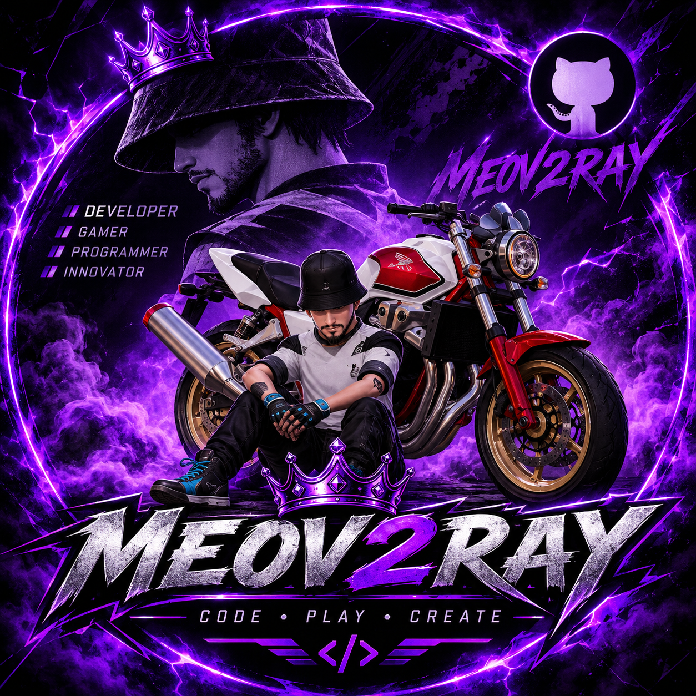

<!-- MEOV2RAY OFFICIAL PROFILE -->

  

  

<h3 align="center">
  <code>FULL STACK DEVELOPER</code>
</h3>

  
  
  

---

"01 / ABOUT ME"

class Developer:
    def __init__(self):
        self.name = "MEOV2RAY"
        self.role = "Developer"
        self.focus = [
            "Software Engineering",
            "Technology",
            "Innovation"
        ]
        self.mindset = "Build something extraordinary"

    def motto(self):
        return "Code is my creative language."

I believe great software starts with curiosity, creativity, and the courage to build something different.

---

"02 / TECHNOLOGY & TOOLS"

  

---

"03 / GITHUB ANALYTICS"

  
  

---

"04 / CONTRIBUTION GRAPH"

  

---

"05 / TROPHIES"

  

---

"06 / CONNECT"

  

  <code>INNOVATE // DEVELOP // REPEAT</code>

  

